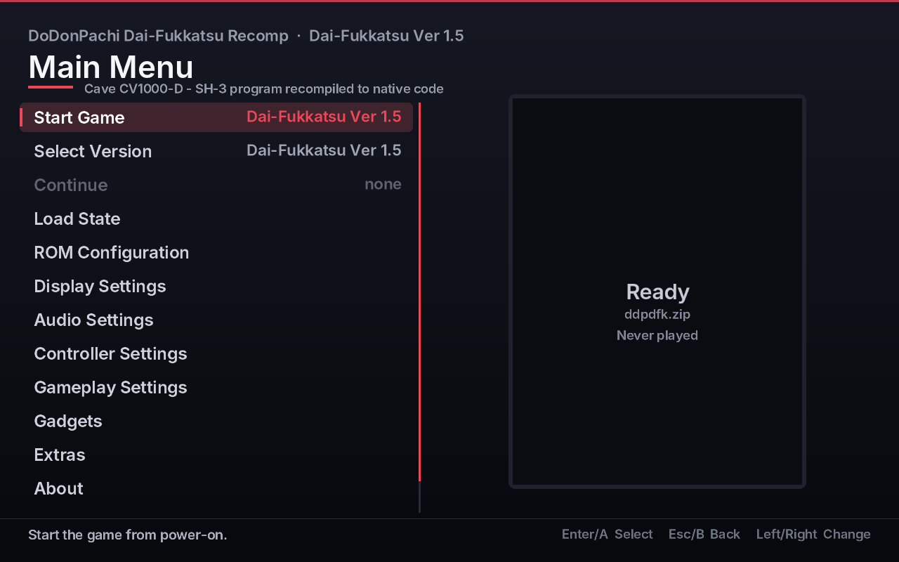
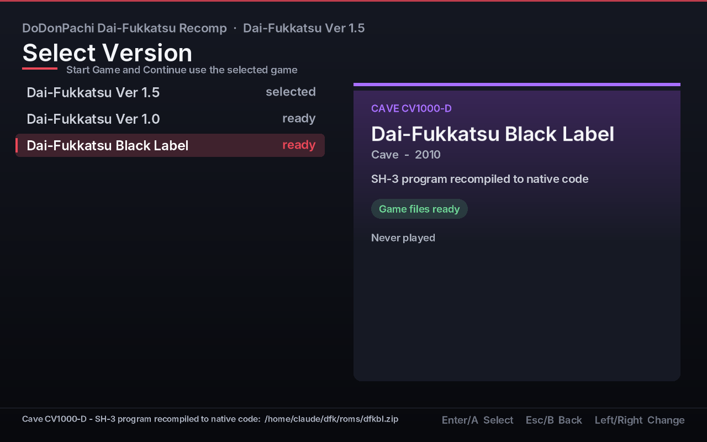

# DoDonPachi Dai-Fukkatsu Recomp

**DoDonPachi Dai-Fukkatsu** Ver 1.5, Ver 1.0 and **Black Label** in one
Windows / Linux / Steam Deck application. The game's SH-3 program is
**recompiled to native code** as it runs. The rest of the CAVE CV1000-D
arcade board is rebuilt after MAME 0.264.

You need your own MAME 0.264 ROM sets. No ROM data, graphics or sound is in
this repository or in any package.



## The versions

| Version | What you need | MAME set |
|---|---|---|
| DoDonPachi Dai-Fukkatsu Ver 1.5 (2008/06/23 MASTER VER 1.5) | `ddpdfk.zip` | `ddpdfk` |
| DoDonPachi Dai-Fukkatsu Ver 1.0 (2008/05/16 MASTER VER) | `ddpdfk10.zip` (its shared files `u23`/`u24` may instead be in `ddpdfk.zip` beside it) | `ddpdfk10` |
| DoDonPachi Dai-Fukkatsu Black Label (2010/1/18 BLACK LABEL) | `dfkbl.zip` | `dfkbl` |

- Every file is checked by name or CRC32; a wrong or incomplete set is
  reported, never replaced by another version.
- The versions are independent: any one of them is enough.

Details: [docs/ROM_SETUP.md](docs/ROM_SETUP.md).

## What this is

| Part | How it is done |
|---|---|
| **SH-3 game program** | **Recompiled while it runs.** The boot program runs from the program ROM and copies the game from the NAND flash into RAM. Code is translated where the CPU reaches it: a new address runs on the interpreter once and is noted; at the end of the frame its code is walked, each instruction becomes a block of C, and the embedded TinyCC compiles the batch into native x86-64 code on a background thread. Each block is MAME 0.264's handler for that instruction with the opcode's fields filled in, inside MAME's execute loop (delay slots, interrupt check, cycle count), so the native code does exactly what the interpreter does. See [docs/RECOMPILER.md](docs/RECOMPILER.md). |
| EP1C12 blitter, YMZ770 sound, NAND flash, RTC9701 clock / EEPROM, scheduler | MAME 0.264's code (imported by a script), with MAME's timing. |
| Game data | Never included. It is read from your ROM files at start-up. |

No game code is distributed: the translation is made on your machine, from
your ROM, while you play.

**Accuracy:** recompiled code and MAME 0.264 were compared on the same inputs
over eight runs: attract mode and 12,000-frame (3.3-minute) play sessions of
all three versions, one and two players.
- The SH-3's registers were identical at every frame, and main RAM at every
  compared frame (every frame or every 10th).
- Every compared screenshot was pixel-identical.
- Save states and rewind round trips were exact.

See [docs/ACCURACY.md](docs/ACCURACY.md).

**Speed:** on the test machine (2 CPU cores) the recompiled program ran
3.0–3.7× real time headless, the interpreter 2.5–3.0×. 99.9% of SH-3 cycles ran in
native code. The interpreter is still built in, and `--interpreter` selects
it.

## Status

| Area | Status |
|---|---|
| ROM validation (zip or folder, every file by name or CRC32; wrong version / incomplete set reported, never substituted) | implemented + tested |
| Recompiled SH-3 | implemented + tested on all three versions; 99.9% of cycles in native code. Code the game rewrites in RAM is dropped and translated again |
| Board accuracy vs MAME 0.264 | identical at every compared frame and screenshot (see ACCURACY.md) |
| Audio | MAME's YMZ770 and MPEG decoder; checked as data against MAME's recording (correlation 0.98–0.99, see ACCURACY.md). **Not listened to** |
| Save states, rewind, input movies, screenshots | implemented + tested (states and rewind exact in headless tests; frontend checked under Xvfb) |
| EEPROM / flash (the game's backup data and settings) | saved per version, written when it changes |
| One application, three versions | implemented + tested under Xvfb: version selector, per-version ROM paths, controls, saves, theme; switching versions |
| Controls | 2 players, 8-way stick, 4 buttons, remappable keyboard and controllers. **No physical controller tested** |
| Windows x64 zip, Steam Deck / Linux AppImage | built and tested (Windows under Wine, AppImage under Xvfb). **Not run on Windows 10/11 hardware or a real Steam Deck** |
| Gameplay | scripted inputs and the keyboard in the frontend. **Not played through by a person** |

## Quick start

1. **Windows:** unzip and run `DFKRecomp-Windows-x86_64.exe`.
   **Steam Deck / Linux:** make the AppImage executable and run it (see
   [docs/STEAM_DECK.md](docs/STEAM_DECK.md)).
2. Open **ROM Configuration** and pick `ddpdfk.zip`, `ddpdfk10.zip` and/or
   `dfkbl.zip`. Zips beside the program are found automatically.
3. **Select Version**, then **Start Game**.
   - Keys: Coin `5`, Start `Enter`, move with the arrow keys, buttons
     `Z X C V`.
   - `Esc`, or Back + Start on a controller, opens the quick menu (save /
     load state, settings, **Switch Version**).
   - See [docs/CONTROLS.md](docs/CONTROLS.md).

The game is vertical (MAME `ROT270`) and is shown upright by default.

On the very first start the board has an empty EEPROM: the game spends
about 25 seconds initialising before the title appears. Later starts use
the saved EEPROM.



## Building

```bash
cmake -S . -B build -G Ninja -DCMAKE_BUILD_TYPE=Release
cmake --build build
./build/bin/DFKRecomp
./build/bin/cv1k_headless --version ddpdfk --rom /path/to/ddpdfk.zip --frames 3000 --png 3000 shot.png
```

- No ROM is needed to build.
- The CMake files ship in the source package attached to each release; they
  are not kept in the git repository.
- Details: [docs/BUILD_LINUX.md](docs/BUILD_LINUX.md),
  [docs/BUILD_WINDOWS.md](docs/BUILD_WINDOWS.md).

## Documentation

- [docs/ROM_SETUP.md](docs/ROM_SETUP.md): the three versions and their files
- [docs/CONTROLS.md](docs/CONTROLS.md): mappings, test and service buttons
- [docs/FRONTEND.md](docs/FRONTEND.md): menus, version switching, display, audio, EEPROM, gadgets
- [docs/SAVE_STATES.md](docs/SAVE_STATES.md): what a state contains, rewind
- [docs/RECOMPILER.md](docs/RECOMPILER.md): how the SH-3 program is recompiled
- [docs/HARDWARE.md](docs/HARDWARE.md): the board model
- [docs/ACCURACY.md](docs/ACCURACY.md): the comparison with MAME, with numbers
- [docs/TESTING.md](docs/TESTING.md): test checklist and compatibility matrix
- [docs/KNOWN_ISSUES.md](docs/KNOWN_ISSUES.md): limitations and remaining work
- [docs/STEAM_DECK.md](docs/STEAM_DECK.md): Steam Deck setup
- [docs/MODIFIED_FILES.md](docs/MODIFIED_FILES.md): reused code and what changed

## Troubleshooting

- **"Not the complete MAME 0.264 set":** the message lists the missing files
  and the files whose CRC is wrong. Use the MAME 0.264 version of the set.
- **"This looks like the set for …":** the zip is another version; pick it
  under that version instead.
- **The first start shows a long black / initialising screen:** the game is
  formatting its EEPROM (about 25 s, once).
- **Slow on an old PC:** start with `--interpreter` to compare. Both are
  exact; on the test machine the recompiled code was faster.
- **The log:** `frontend.log` is in the data folder (Extras shows its path).

## Contributing

- Issues and pull requests are welcome.
- Never attach ROMs, ROM-derived data or recompiled output.
- Changes to the board or the recompiler should keep the headless comparison
  with MAME identical; see [docs/ACCURACY.md](docs/ACCURACY.md) for how to
  record references, and `ctest`.

## Licences

- This project's own code is GPL-2.0 (`LICENSE`).
- The SH-3 interpreter and recompiler templates, EP1C12, YMZ770 / MPEG audio,
  NAND, RTC9701 and the CV1000 board follow MAME code (BSD-3-Clause).
- TinyCC: LGPL-2.1. SDL2: zlib. miniz: MIT. Inter font: OFL.
- See `LICENSES/`.

*DoDonPachi Dai-Fukkatsu* is © CAVE / AMI. This project is not affiliated
with or endorsed by CAVE or AMI.
